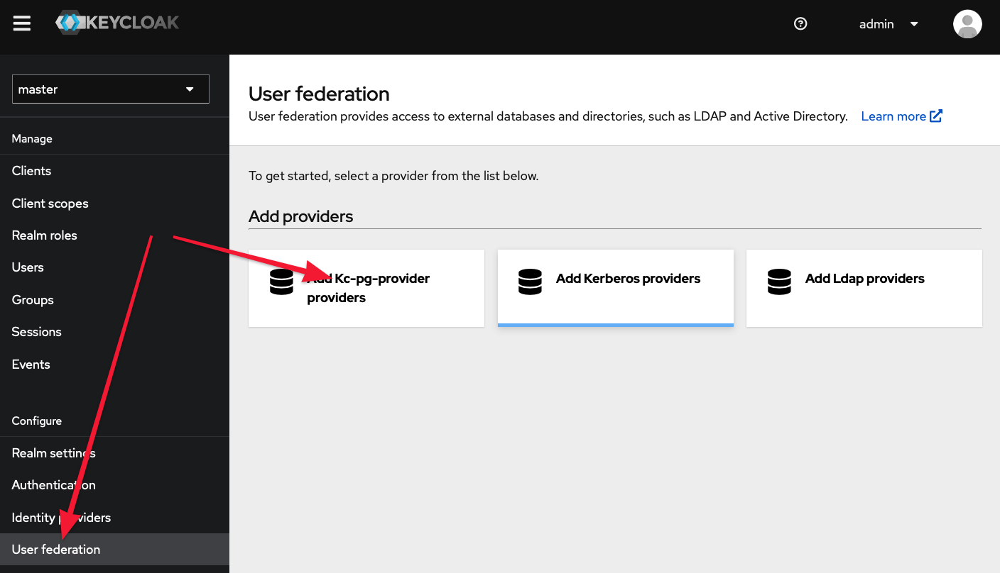

# OBP Keycloak Provider

Keycloak User Storage SPI that authenticates users via the **OBP REST API** instead of direct database access. No JDBC drivers, no SQL views — authentication delegates entirely to OBP endpoints.

## How it works

1. On first request the provider obtains an admin Direct Login token via `POST /obp/v6.0.0/my/logins/direct`
2. User lookup: `GET /obp/v6.0.0/users/provider/{PROVIDER}/username/{USERNAME}`
3. Credential verification: `POST /obp/v6.0.0/users/verify-credentials` (username + password + provider)
4. Only users whose OBP `provider` field matches `OBP_AUTHUSER_PROVIDER` are accepted

Required roles on the OBP admin account: `CanGetAnyUser`, `CanVerifyUserCredentials`, `CanGetOidcClient`, and for client storage `CanVerifyOidcClient`

## Clients from OBP (client storage)

The same jar also lets Keycloak find its OAuth2/OIDC clients in OBP, so an app is registered once, as an OBP Consumer, and never duplicated as a Keycloak client:

1. Keycloak looks up its own clients first; a `client_id` it does not have is looked up with `GET /obp/v6.0.0/oidc/clients/{CLIENT_ID}`. The client_id is the Consumer's key.
2. The client secret stays in OBP: Keycloak checks the presented secret with `POST /obp/v6.0.0/oidc/clients/verify`.
3. Name, redirect URLs, enabled and grant types come from the Consumer; everything else is a fixed confidential OpenID Connect client (the realm's default client scopes). People log in through it only when the Consumer's grant types include `authorization_code` (a Consumer that sets none allows it). Clients from OBP are read only in Keycloak.
4. OBP-API recognises the token's `azp` as the Consumer's key, so it uses the registered Consumer and creates no second one.

Lookups are cached per client_id for 60 seconds (10 seconds when not found). Enable it per realm with the Admin REST API (the admin console has no screen for client storage):

```
POST /admin/realms/{realm}/components
{"name": "obp-clients", "providerId": "obp-client-storage",
 "providerType": "org.keycloak.storage.client.ClientStorageProvider", "parentId": "{realm id}"}
```

Not supported yet for clients from OBP: public clients (no secret), service accounts (client credentials grant: use a client stored in Keycloak itself for an application acting as itself), and client-specific mappers or roles.

## Requirements

* [Git](https://git-scm.com) 2.2.1 or later
* [Docker Engine](https://docs.docker.com/engine/install/) or [Docker Desktop](https://docs.docker.com/desktop/) 1.9 or later
* [Maven](https://maven.apache.org/) 3.8.5 or later
* [Java](https://www.java.com/ru/) 17 or later

## Quick Start

1. **Copy and configure environment variables:**
   ```shell
   cp env.sample .env
   nano .env
   ```

2. **Deploy locally:**
   ```shell
   ./development/run-local-postgres-cicd.sh
   # or with OBP themes:
   ./development/run-local-postgres-cicd.sh --themed
   ```

## Key Environment Variables

| Variable | Description |
|----------|-------------|
| **OBP API** | |
| `OBP_API_URL` | Base URL of the OBP API instance (e.g. `http://localhost:8080`) |
| `OBP_API_USERNAME` | OBP admin username (must hold required roles) |
| `OBP_API_PASSWORD` | OBP admin password |
| `OBP_API_CONSUMER_KEY` | Consumer key registered in OBP for Direct Login |
| `OBP_AUTHUSER_PROVIDER` | **Mandatory** — only users with this provider value are authenticated |
| **Keycloak Admin** | |
| `KEYCLOAK_ADMIN` | Keycloak admin username (default: `admin`) |
| `KEYCLOAK_ADMIN_PASSWORD` | Keycloak admin password (default: `admin`) |
| **Keycloak Database** | |
| `KC_DB_URL` | Keycloak's internal PostgreSQL JDBC URL |
| `KC_DB_USERNAME` | Keycloak database user (default: `keycloak`) |
| `KC_DB_PASSWORD` | Keycloak database password |
| **Ports** | |
| `KEYCLOAK_HTTP_PORT` | HTTP port (default: `7787`) |
| `KEYCLOAK_HTTPS_PORT` | HTTPS port (default: `8443`) |
| `KEYCLOAK_MGMT_PORT` | Management/health port (default: `9000`) |

See [env.sample](env.sample) for the full reference.

## Provider Features

- ✅ User lookup and authentication via OBP REST API
- ✅ Password verification delegated to OBP (`verify-credentials`)
- ✅ Provider-based user filtering (`OBP_AUTHUSER_PROVIDER`)
- ✅ Admin token caching with automatic refresh on expiry
- 🔴 User creation / update / deletion — read-only by design (manage users in OBP)

## Login to Keycloak

After deploying, open [https://localhost:8443](https://localhost:8443).

Default admin credentials:
```
user: admin
pass: admin
```

Click the [User federation](https://localhost:8443/admin/master/console/#/master/user-federation) tab — `obp-keycloak-provider` will be listed.



## Documentation

- [env.sample](env.sample) — full environment variable reference
- [docs/CICD_DEPLOYMENT.md](docs/CICD_DEPLOYMENT.md) — CI/CD deployment guide
- [development/README.md](development/README.md) — development scripts documentation

## Writing documentation

Write documentation, error messages, log messages and code comments in plain English. Plain English is not
simplified English: it keeps the meaning and the detail, and says it clearly. Two UK guides explain how:

- [Clear language](https://guidance.publishing.service.gov.uk/writing-to-gov-uk-standards/writing-guidelines/clear-language/) from GOV.UK
- [How to write in plain English](https://www.plainenglish.co.uk/how-to-write-in-plain-english) from the Plain English Campaign

In short:

- Keep sentences to 15 to 20 words on average, and split any sentence over 25 words.
- Use the active voice: "Keycloak asks OBP to check the secret", not "the secret is checked by OBP".
- Use short, familiar words: "start", not "commence"; "before", not "prior to".
- Explain a technical term the first time you use it. Specialists prefer plain English too.
- Write full sentences. Avoid long chains joined by semicolons, and make sure every "it" and "they" clearly
  refers to one thing.
- Give an example when a rule is hard to follow on its own.
